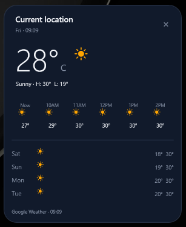
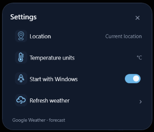

# clim8 for Windows (`v1.0.0`)

A compact Windows desktop weather client featuring a dark forecast card, a matching settings panel, and a rounded system tray action menu powered by the [Google Weather API](https://developers.google.com/maps/documentation/weather).

## Screenshots

| Weather Forecast Card | Settings Panel |
| :---: | :---: |
|  |  |

## Quick Install (Windows x64 Release `1.0.0`)

1. Download **`Clim8-Windows-x64-v1.0.0.zip`** from the [GitHub Releases](https://github.com/GreenDiary/clim8/releases/tag/v1.0.0) page and extract all files into a folder on your system (keep `Clim8.exe` alongside its `.dll`, `.json`, and `assets/` dependencies).
2. Ensure the [.NET 10.0 Windows Desktop Runtime (x64)](https://dotnet.microsoft.com/en-us/download/dotnet/10.0) is installed.
3. Configure your Google Weather API key as a user environment variable in PowerShell (see [Google Weather API Key Setup](https://developers.google.com/maps/documentation/weather/get-api-key)):

~~~powershell
[Environment]::SetEnvironmentVariable('CLIM8_GOOGLE_WEATHER_API_KEY', 'YOUR_API_KEY', 'User')
~~~

4. Launch **`Clim8.exe`** and grant Windows location permission when prompted.

## Requirements and Setup (Building from Source)

- [.NET 10 SDK](https://dotnet.microsoft.com/en-us/download/dotnet/10.0) and x64 Windows Desktop Runtime.
- A Google Cloud project with the [Google Weather API](https://developers.google.com/maps/documentation/weather) enabled and billing configured.
- The API key set as `CLIM8_GOOGLE_WEATHER_API_KEY`. Clim8 does not store or embed this key and sends it in Google's `x-goog-api-key` request header.

To set the key for your Windows user, run this in PowerShell and restart Clim8:

~~~powershell
[Environment]::SetEnvironmentVariable('CLIM8_GOOGLE_WEATHER_API_KEY', 'YOUR_API_KEY', 'User')
~~~

Restrict the key to the Google Weather API in Google Cloud. See [Google Weather API setup](https://developers.google.com/maps/documentation/weather/get-api-key) and the [Weather API overview](https://developers.google.com/maps/documentation/weather).

Build with:

~~~powershell
dotnet build Clim8.Windows.csproj --configuration Release
~~~

Run `bin/Release/net10.0-windows10.0.26100.0/Clim8.exe`. A normal launch opens the weather card; `--background` is reserved for Windows startup and keeps the app in the notification area.

## Location and Weather

On the first interactive launch, Clim8 asks Windows for permission to read the device location. If allowed, Windows provides a one-time device position and Clim8 uses it for current conditions and forecasts. Location is saved locally with the settings. The Location row in Settings refreshes the device position. If permission is denied, use Windows Settings > Privacy & security > Location, then click Location again. Windows shows its permission prompt once per app.

Clim8 sends the coordinates to Google's current conditions, hourly forecast, and daily forecast endpoints. Weather refreshes when the card opens if the saved forecast is older than ten minutes. While the card stays open, it refreshes every fifteen minutes. Closing the card stops that timer, and the tray-idle app does not poll. The location label is `Current location` because this build does not perform a separate place-name lookup.

Google Weather API requests require the key above and are subject to Google Maps Platform billing and usage limits. No API key is included in the source or release ZIP.

## Windows and Tray Controls

- Single-click the Clim8 notification icon to open the weather card.
- Double-click or right-click the icon to open the rounded **Open clim8**, **Settings**, and **Quit** menu.
- Drag the weather card by its background to move it. It appears in the taskbar while open and follows the normal window stacking order.
- The notification tooltip shows only the app name. Clim8 has no temperature-on-hover popup.
- Click the city label to refresh weather. Click the temperature to switch between Celsius and Fahrenheit. Click × to close the card.
- Settings include device location refresh, temperature units, Windows startup, and weather refresh.

The main card shows current conditions, up to six hourly readings, and a five-day forecast. Weather and Settings artwork is pre-rendered as PNG for low-overhead WPF display. The source SVG artwork is retained in this source archive and is not copied into the release app.

Windows controls which notification icons appear in the visible taskbar area and which are under the hidden-icons arrow. Drag Clim8 from the hidden-icons panel to the notification area if you want it visible beside the clock.

On first run, Clim8 attempts to enable startup for the current Windows user. Settings are saved to `%LOCALAPPDATA%\Clim8\settings.json` when writable.
